# ExpiryWatch India - draft evidence packs (spot-only, Tier A)
> **Surveillance priority only - NOT evidence of manipulation or any legal violation.** Tiers are surveillance-priority labels from MIRS-lite; Red is not assignable without cross-market evidence.
> Every card lists legitimate explanations first. These drafts become evidence packs only after WP7 news evidence is filled in.

## 2020-03-12 - Weekly expiry, regime R01 - **Amber**
*Selected because:* negative control (listed event)   |   *Run:* retrospective only

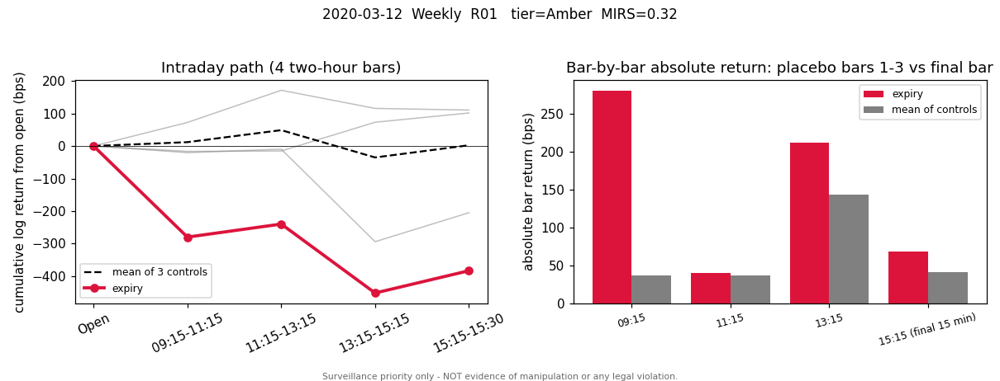

| Measure | Expiry | Mean of 3 controls |
|---|---|---|
| Day return | -7.81% | - |
| Intraday realised vol (EVR vs controls) | 3.60%  (EVR 2.05) | 1.76% |
| Final 15 min absolute return | 68.5 bps | 40.9 bps |
| Final 15 min range | 93.2 bps | 56.2 bps |
| Last-bar share of price path | 11.4% | 15.1% |
| Overnight gap (signed) | -4.20% | - |
| Next-day return | +4.05% | - |
| Listed events within +-5 days | 1 | - |

**Score components (past-only percentiles):** A (whole-day anomaly) 0.96 | T (settlement timing) 0.76 | R (reversal) 0.65 | Recurrence 0.00 | signals 1 | U 0.65 | news explanation 1.00 | **MIRS 0.32** | rank 251 of 367

ML consensus (median of IF/LOF/SVM percentiles) 0.98; at least 2 of 3 models above 0.90: yes  (secondary flag; ML is not inside MIRS)

**Strongest legitimate explanations to test FIRST (devil's-advocate rule; auto-generated hypotheses, not findings):**
- A listed information event falls on or within 5 days of this expiry: news / price discovery is a leading explanation.
- Delta/gamma hedging, roll/unwind, arbitrage convergence, index rebalancing and liquidity cannot be tested with spot-only data
  (need OI by strike, futures, constituents, volume/spread/depth).

**WP7 news / information evidence (to be filled with dated, cited sources before any conclusion):**
- [ ] RBI / macro release on or before this date:  source ______  time ______
- [ ] Corporate or index announcement (heavy NIFTY constituents):  source ______  time ______
- [ ] Global market move overnight / intraday:  source ______  time ______
- Conclusion (one sentence, in surveillance language): ______

**Data needed to go further:** F&O bhavcopy (OI, strike distribution, futures basis), constituent prices and weights, intraday volume.
> Surveillance priority only - NOT evidence of manipulation or any legal violation.

---

## 2021-12-16 - Weekly expiry, regime R02 - **Orange**
*Selected because:* Orange (retrospective)   |   *Run:* retrospective only

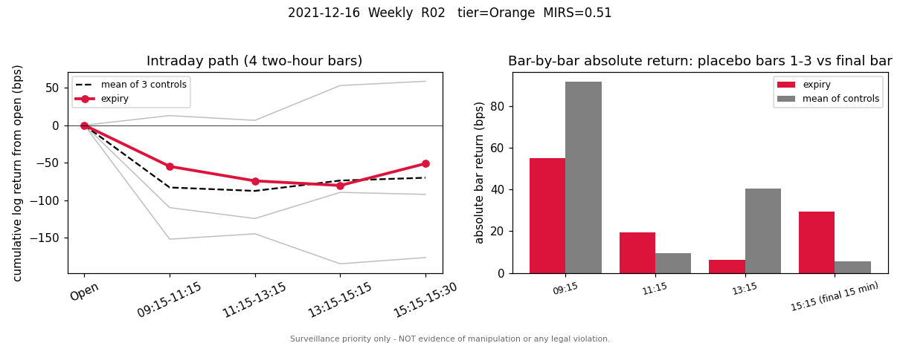

| Measure | Expiry | Mean of 3 controls |
|---|---|---|
| Day return | +0.45% | - |
| Intraday realised vol (EVR vs controls) | 0.65%  (EVR 0.61) | 1.08% |
| Final 15 min absolute return | 29.2 bps | 5.6 bps |
| Final 15 min range | 29.5 bps | 13.3 bps |
| Last-bar share of price path | 26.7% | 4.5% |
| Overnight gap (signed) | +0.97% | - |
| Next-day return | -1.69% | - |
| Listed events within +-5 days | 0 | - |

**Score components (past-only percentiles):** A (whole-day anomaly) 0.25 | T (settlement timing) 0.99 | R (reversal) 0.96 | Recurrence 0.00 | signals 2 | U 0.60 | news explanation 0.32 | **MIRS 0.51** | rank 94 of 367

ML consensus (median of IF/LOF/SVM percentiles) 1.00; at least 2 of 3 models above 0.90: yes  (secondary flag; ML is not inside MIRS)

**Strongest legitimate explanations to test FIRST (devil's-advocate rule; auto-generated hypotheses, not findings):**
- Extreme overnight gap: information probably arrived before the open.
- Large next-day reversal: can come from hedging, inventory or liquidity effects; it must never be used alone (proposal 9.4).
- Quiet day overall but an active close: look at roll/unwind, delta hedging and VWAP-targeting execution first.
- Delta/gamma hedging, roll/unwind, arbitrage convergence, index rebalancing and liquidity cannot be tested with spot-only data
  (need OI by strike, futures, constituents, volume/spread/depth).

**WP7 news / information evidence (to be filled with dated, cited sources before any conclusion):**
- [ ] RBI / macro release on or before this date:  source ______  time ______
- [ ] Corporate or index announcement (heavy NIFTY constituents):  source ______  time ______
- [ ] Global market move overnight / intraday:  source ______  time ______
- Conclusion (one sentence, in surveillance language): ______

**Data needed to go further:** F&O bhavcopy (OI, strike distribution, futures basis), constituent prices and weights, intraday volume.
> Surveillance priority only - NOT evidence of manipulation or any legal violation.

---

## 2022-03-10 - Weekly expiry, regime R02 - **Amber**
*Selected because:* top-4 settlement-timing T (walk-forward)   |   *Run:* walk-forward (out-of-sample)

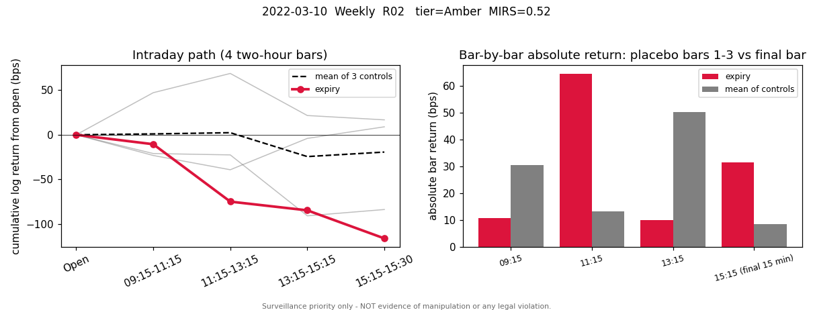

| Measure | Expiry | Mean of 3 controls |
|---|---|---|
| Day return | +1.18% | - |
| Intraday realised vol (EVR vs controls) | 0.73%  (EVR 1.16) | 0.63% |
| Final 15 min absolute return | 31.5 bps | 8.3 bps |
| Final 15 min range | 40.5 bps | 17.8 bps |
| Last-bar share of price path | 27.1% | 8.7% |
| Overnight gap (signed) | +2.37% | - |
| Next-day return | +0.35% | - |
| Listed events within +-5 days | 0 | - |

**Score components (past-only percentiles):** A (whole-day anomaly) 0.78 | T (settlement timing) 0.98 | R (reversal) 0.35 | Recurrence 0.25 | signals 1 | U 0.72 | news explanation 0.54 | **MIRS 0.52** | rank 55 of 239

ML consensus (median of IF/LOF/SVM percentiles) 0.96; at least 2 of 3 models above 0.90: yes  (secondary flag; ML is not inside MIRS)

**Strongest legitimate explanations to test FIRST (devil's-advocate rule; auto-generated hypotheses, not findings):**
- Extreme overnight gap: information probably arrived before the open.
- Delta/gamma hedging, roll/unwind, arbitrage convergence, index rebalancing and liquidity cannot be tested with spot-only data
  (need OI by strike, futures, constituents, volume/spread/depth).

**WP7 news / information evidence (to be filled with dated, cited sources before any conclusion):**
- [ ] RBI / macro release on or before this date:  source ______  time ______
- [ ] Corporate or index announcement (heavy NIFTY constituents):  source ______  time ______
- [ ] Global market move overnight / intraday:  source ______  time ______
- Conclusion (one sentence, in surveillance language): ______

**Data needed to go further:** F&O bhavcopy (OI, strike distribution, futures basis), constituent prices and weights, intraday volume.
> Surveillance priority only - NOT evidence of manipulation or any legal violation.

---

## 2022-03-24 - Weekly expiry, regime R02 - **Amber**
*Selected because:* top-8 MIRS (walk-forward)   |   *Run:* walk-forward (out-of-sample)

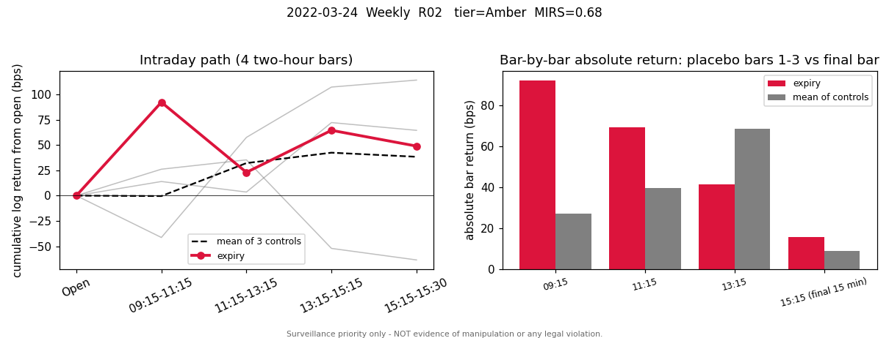

| Measure | Expiry | Mean of 3 controls |
|---|---|---|
| Day return | -0.15% | - |
| Intraday realised vol (EVR vs controls) | 1.24%  (EVR 1.31) | 0.94% |
| Final 15 min absolute return | 15.6 bps | 8.6 bps |
| Final 15 min range | 21.8 bps | 14.7 bps |
| Last-bar share of price path | 7.1% | 6.5% |
| Overnight gap (signed) | -0.64% | - |
| Next-day return | -0.11% | - |
| Listed events within +-5 days | 0 | - |

**Score components (past-only percentiles):** A (whole-day anomaly) 0.82 | T (settlement timing) 0.71 | R (reversal) 0.50 | Recurrence 0.50 | signals 1 | U 0.68 | news explanation 0.00 | **MIRS 0.68** | rank 6 of 239

ML consensus (median of IF/LOF/SVM percentiles) 0.24; at least 2 of 3 models above 0.90: no  (secondary flag; ML is not inside MIRS)

**Strongest legitimate explanations to test FIRST (devil's-advocate rule; auto-generated hypotheses, not findings):**
- No rule-based innocent explanation triggered; test the generic ones below.
- Delta/gamma hedging, roll/unwind, arbitrage convergence, index rebalancing and liquidity cannot be tested with spot-only data
  (need OI by strike, futures, constituents, volume/spread/depth).

**WP7 news / information evidence (to be filled with dated, cited sources before any conclusion):**
- [ ] RBI / macro release on or before this date:  source ______  time ______
- [ ] Corporate or index announcement (heavy NIFTY constituents):  source ______  time ______
- [ ] Global market move overnight / intraday:  source ______  time ______
- Conclusion (one sentence, in surveillance language): ______

**Data needed to go further:** F&O bhavcopy (OI, strike distribution, futures basis), constituent prices and weights, intraday volume.
> Surveillance priority only - NOT evidence of manipulation or any legal violation.

---

## 2023-01-25 - Monthly expiry, regime R02 - **Amber**
*Selected because:* negative control (listed event)   |   *Run:* walk-forward (out-of-sample)

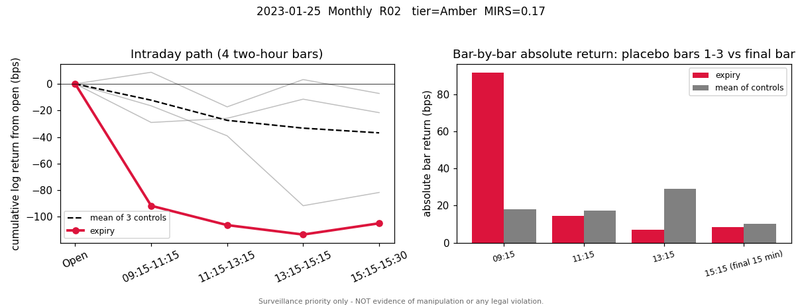

| Measure | Expiry | Mean of 3 controls |
|---|---|---|
| Day return | -1.07% | - |
| Intraday realised vol (EVR vs controls) | 0.94%  (EVR 2.15) | 0.43% |
| Final 15 min absolute return | 8.5 bps | 10.2 bps |
| Final 15 min range | 11.8 bps | 16.7 bps |
| Last-bar share of price path | 6.9% | 14.5% |
| Overnight gap (signed) | -0.02% | - |
| Next-day return | -1.69% | - |
| Listed events within +-5 days | 1 | - |

**Score components (past-only percentiles):** A (whole-day anomaly) 0.93 | T (settlement timing) 0.22 | R (reversal) 0.03 | Recurrence 0.00 | signals 1 | U 0.33 | news explanation 1.00 | **MIRS 0.17** | rank 235 of 239

ML consensus (median of IF/LOF/SVM percentiles) 0.44; at least 2 of 3 models above 0.90: no  (secondary flag; ML is not inside MIRS)

**Strongest legitimate explanations to test FIRST (devil's-advocate rule; auto-generated hypotheses, not findings):**
- Monthly expiry: larger open interest is rolled, hedged or unwound into the close (WP2 found the final-bar effect concentrated in monthlies). Needs OI/rollover data to test.
- A listed information event falls on or within 5 days of this expiry: news / price discovery is a leading explanation.
- The whole-day volatility is unusual but the settlement-window evidence is weak: the move happened earlier in the day.
- Delta/gamma hedging, roll/unwind, arbitrage convergence, index rebalancing and liquidity cannot be tested with spot-only data
  (need OI by strike, futures, constituents, volume/spread/depth).

**WP7 news / information evidence (to be filled with dated, cited sources before any conclusion):**
- [ ] RBI / macro release on or before this date:  source ______  time ______
- [ ] Corporate or index announcement (heavy NIFTY constituents):  source ______  time ______
- [ ] Global market move overnight / intraday:  source ______  time ______
- Conclusion (one sentence, in surveillance language): ______

**Data needed to go further:** F&O bhavcopy (OI, strike distribution, futures basis), constituent prices and weights, intraday volume.
> Surveillance priority only - NOT evidence of manipulation or any legal violation.

---

## 2023-07-06 - Weekly expiry, regime R03 - **Amber**
*Selected because:* top-8 MIRS (walk-forward)   |   *Run:* walk-forward (out-of-sample)

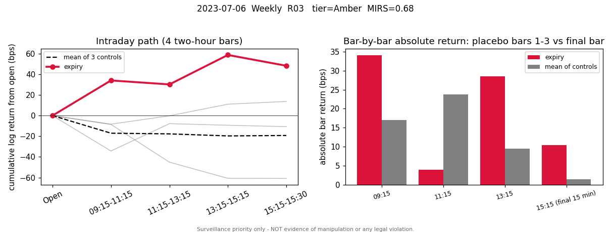

| Measure | Expiry | Mean of 3 controls |
|---|---|---|
| Day return | +0.36% | - |
| Intraday realised vol (EVR vs controls) | 0.46%  (EVR 1.37) | 0.33% |
| Final 15 min absolute return | 10.5 bps | 1.4 bps |
| Final 15 min range | 11.7 bps | 9.8 bps |
| Last-bar share of price path | 13.6% | 3.7% |
| Overnight gap (signed) | -0.13% | - |
| Next-day return | -0.82% | - |
| Listed events within +-5 days | 0 | - |

**Score components (past-only percentiles):** A (whole-day anomaly) 0.83 | T (settlement timing) 0.83 | R (reversal) 0.93 | Recurrence 0.00 | signals 1 | U 0.68 | news explanation 0.00 | **MIRS 0.68** | rank 7 of 239

ML consensus (median of IF/LOF/SVM percentiles) 0.98; at least 2 of 3 models above 0.90: yes  (secondary flag; ML is not inside MIRS)

**Strongest legitimate explanations to test FIRST (devil's-advocate rule; auto-generated hypotheses, not findings):**
- Large next-day reversal: can come from hedging, inventory or liquidity effects; it must never be used alone (proposal 9.4).
- Delta/gamma hedging, roll/unwind, arbitrage convergence, index rebalancing and liquidity cannot be tested with spot-only data
  (need OI by strike, futures, constituents, volume/spread/depth).

**WP7 news / information evidence (to be filled with dated, cited sources before any conclusion):**
- [ ] RBI / macro release on or before this date:  source ______  time ______
- [ ] Corporate or index announcement (heavy NIFTY constituents):  source ______  time ______
- [ ] Global market move overnight / intraday:  source ______  time ______
- Conclusion (one sentence, in surveillance language): ______

**Data needed to go further:** F&O bhavcopy (OI, strike distribution, futures basis), constituent prices and weights, intraday volume.
> Surveillance priority only - NOT evidence of manipulation or any legal violation.

---

## 2023-11-16 - Weekly expiry, regime R03 - **Amber**
*Selected because:* top-8 MIRS (walk-forward)   |   *Run:* walk-forward (out-of-sample)

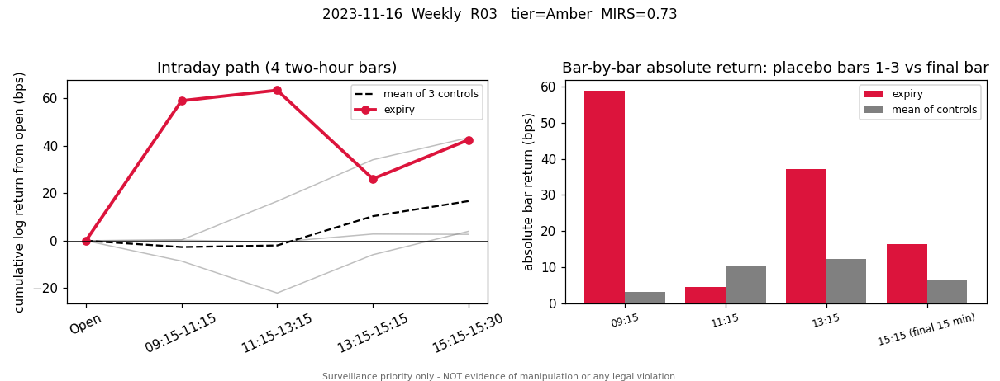

| Measure | Expiry | Mean of 3 controls |
|---|---|---|
| Day return | +0.44% | - |
| Intraday realised vol (EVR vs controls) | 0.72%  (EVR 4.00) | 0.18% |
| Final 15 min absolute return | 16.5 bps | 6.4 bps |
| Final 15 min range | 21.6 bps | 12.0 bps |
| Last-bar share of price path | 14.1% | 14.9% |
| Overnight gap (signed) | +0.02% | - |
| Next-day return | -0.22% | - |
| Listed events within +-5 days | 0 | - |

**Score components (past-only percentiles):** A (whole-day anomaly) 0.99 | T (settlement timing) 0.80 | R (reversal) 0.69 | Recurrence 0.25 | signals 1 | U 0.73 | news explanation 0.00 | **MIRS 0.73** | rank 2 of 239

ML consensus (median of IF/LOF/SVM percentiles) 0.98; at least 2 of 3 models above 0.90: yes  (secondary flag; ML is not inside MIRS)

**Strongest legitimate explanations to test FIRST (devil's-advocate rule; auto-generated hypotheses, not findings):**
- No rule-based innocent explanation triggered; test the generic ones below.
- Delta/gamma hedging, roll/unwind, arbitrage convergence, index rebalancing and liquidity cannot be tested with spot-only data
  (need OI by strike, futures, constituents, volume/spread/depth).

**WP7 news / information evidence (to be filled with dated, cited sources before any conclusion):**
- [ ] RBI / macro release on or before this date:  source ______  time ______
- [ ] Corporate or index announcement (heavy NIFTY constituents):  source ______  time ______
- [ ] Global market move overnight / intraday:  source ______  time ______
- Conclusion (one sentence, in surveillance language): ______

**Data needed to go further:** F&O bhavcopy (OI, strike distribution, futures basis), constituent prices and weights, intraday volume.
> Surveillance priority only - NOT evidence of manipulation or any legal violation.

---

## 2023-12-21 - Weekly expiry, regime R03 - **Green**
*Selected because:* top-8 MIRS (walk-forward)   |   *Run:* walk-forward (out-of-sample)

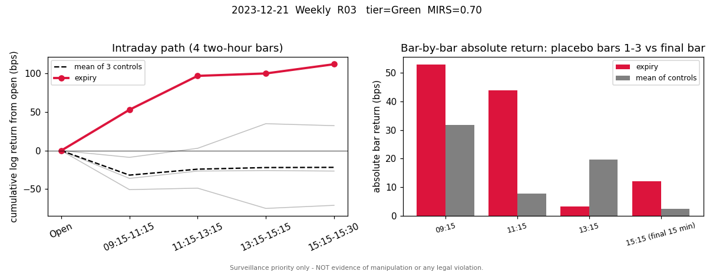

| Measure | Expiry | Mean of 3 controls |
|---|---|---|
| Day return | +0.84% | - |
| Intraday realised vol (EVR vs controls) | 0.70%  (EVR 1.62) | 0.43% |
| Final 15 min absolute return | 12.0 bps | 2.4 bps |
| Final 15 min range | 18.1 bps | 8.8 bps |
| Last-bar share of price path | 10.7% | 3.6% |
| Overnight gap (signed) | -0.29% | - |
| Next-day return | +0.23% | - |
| Listed events within +-5 days | 0 | - |

**Score components (past-only percentiles):** A (whole-day anomaly) 0.88 | T (settlement timing) 0.85 | R (reversal) 0.44 | Recurrence 0.25 | signals 0 | U 0.70 | news explanation 0.00 | **MIRS 0.70** | rank 5 of 239

ML consensus (median of IF/LOF/SVM percentiles) 0.21; at least 2 of 3 models above 0.90: no  (secondary flag; ML is not inside MIRS)

**Strongest legitimate explanations to test FIRST (devil's-advocate rule; auto-generated hypotheses, not findings):**
- No rule-based innocent explanation triggered; test the generic ones below.
- Delta/gamma hedging, roll/unwind, arbitrage convergence, index rebalancing and liquidity cannot be tested with spot-only data
  (need OI by strike, futures, constituents, volume/spread/depth).

**WP7 news / information evidence (to be filled with dated, cited sources before any conclusion):**
- [ ] RBI / macro release on or before this date:  source ______  time ______
- [ ] Corporate or index announcement (heavy NIFTY constituents):  source ______  time ______
- [ ] Global market move overnight / intraday:  source ______  time ______
- Conclusion (one sentence, in surveillance language): ______

**Data needed to go further:** F&O bhavcopy (OI, strike distribution, futures basis), constituent prices and weights, intraday volume.
> Surveillance priority only - NOT evidence of manipulation or any legal violation.

---

## 2024-02-01 - Weekly expiry, regime R03 - **Green**
*Selected because:* negative control (listed event)   |   *Run:* walk-forward (out-of-sample)

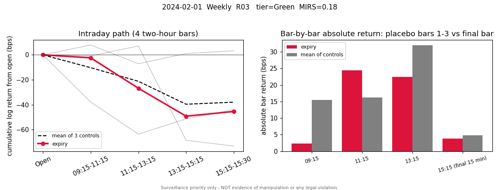

| Measure | Expiry | Mean of 3 controls |
|---|---|---|
| Day return | -0.09% | - |
| Intraday realised vol (EVR vs controls) | 0.33%  (EVR 0.70) | 0.48% |
| Final 15 min absolute return | 3.8 bps | 4.8 bps |
| Final 15 min range | 13.1 bps | 12.0 bps |
| Last-bar share of price path | 7.1% | 6.9% |
| Overnight gap (signed) | +0.36% | - |
| Next-day return | +0.76% | - |
| Listed events within +-5 days | 1 | - |

**Score components (past-only percentiles):** A (whole-day anomaly) 0.34 | T (settlement timing) 0.50 | R (reversal) 0.50 | Recurrence 0.00 | signals 0 | U 0.36 | news explanation 1.00 | **MIRS 0.18** | rank 234 of 239

ML consensus (median of IF/LOF/SVM percentiles) 0.31; at least 2 of 3 models above 0.90: no  (secondary flag; ML is not inside MIRS)

**Strongest legitimate explanations to test FIRST (devil's-advocate rule; auto-generated hypotheses, not findings):**
- A listed information event falls on or within 5 days of this expiry: news / price discovery is a leading explanation.
- Delta/gamma hedging, roll/unwind, arbitrage convergence, index rebalancing and liquidity cannot be tested with spot-only data
  (need OI by strike, futures, constituents, volume/spread/depth).

**WP7 news / information evidence (to be filled with dated, cited sources before any conclusion):**
- [ ] RBI / macro release on or before this date:  source ______  time ______
- [ ] Corporate or index announcement (heavy NIFTY constituents):  source ______  time ______
- [ ] Global market move overnight / intraday:  source ______  time ______
- Conclusion (one sentence, in surveillance language): ______

**Data needed to go further:** F&O bhavcopy (OI, strike distribution, futures basis), constituent prices and weights, intraday volume.
> Surveillance priority only - NOT evidence of manipulation or any legal violation.

---

## 2024-03-28 - Monthly expiry, regime R03 - **Amber**
*Selected because:* Orange (retrospective)   |   *Run:* walk-forward (out-of-sample)

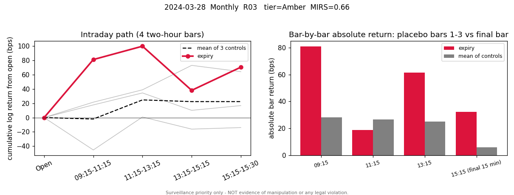

| Measure | Expiry | Mean of 3 controls |
|---|---|---|
| Day return | +0.89% | - |
| Intraday realised vol (EVR vs controls) | 1.08%  (EVR 2.22) | 0.49% |
| Final 15 min absolute return | 32.4 bps | 5.9 bps |
| Final 15 min range | 35.5 bps | 10.8 bps |
| Last-bar share of price path | 16.7% | 7.6% |
| Overnight gap (signed) | +0.18% | - |
| Next-day return | +0.56% | - |
| Listed events within +-5 days | 0 | - |

**Score components (past-only percentiles):** A (whole-day anomaly) 0.95 | T (settlement timing) 0.88 | R (reversal) 0.28 | Recurrence 0.00 | signals 1 | U 0.66 | news explanation 0.00 | **MIRS 0.66** | rank 10 of 239

ML consensus (median of IF/LOF/SVM percentiles) 0.73; at least 2 of 3 models above 0.90: no  (secondary flag; ML is not inside MIRS)

**Strongest legitimate explanations to test FIRST (devil's-advocate rule; auto-generated hypotheses, not findings):**
- Monthly expiry: larger open interest is rolled, hedged or unwound into the close (WP2 found the final-bar effect concentrated in monthlies). Needs OI/rollover data to test.
- Delta/gamma hedging, roll/unwind, arbitrage convergence, index rebalancing and liquidity cannot be tested with spot-only data
  (need OI by strike, futures, constituents, volume/spread/depth).

**WP7 news / information evidence (to be filled with dated, cited sources before any conclusion):**
- [ ] RBI / macro release on or before this date:  source ______  time ______
- [ ] Corporate or index announcement (heavy NIFTY constituents):  source ______  time ______
- [ ] Global market move overnight / intraday:  source ______  time ______
- Conclusion (one sentence, in surveillance language): ______

**Data needed to go further:** F&O bhavcopy (OI, strike distribution, futures basis), constituent prices and weights, intraday volume.
> Surveillance priority only - NOT evidence of manipulation or any legal violation.

---

## 2024-04-18 - Weekly expiry, regime R03 - **Orange**
*Selected because:* Orange (walk-forward), Orange (retrospective), top-8 MIRS (walk-forward)   |   *Run:* walk-forward (out-of-sample)

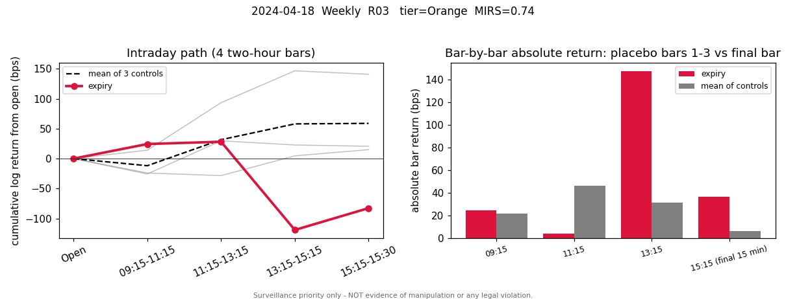

| Measure | Expiry | Mean of 3 controls |
|---|---|---|
| Day return | -0.59% | - |
| Intraday realised vol (EVR vs controls) | 1.54%  (EVR 2.30) | 0.67% |
| Final 15 min absolute return | 36.4 bps | 6.0 bps |
| Final 15 min range | 39.2 bps | 16.5 bps |
| Last-bar share of price path | 17.2% | 6.8% |
| Overnight gap (signed) | +0.23% | - |
| Next-day return | +0.47% | - |
| Listed events within +-5 days | 0 | - |

**Score components (past-only percentiles):** A (whole-day anomaly) 0.94 | T (settlement timing) 0.95 | R (reversal) 0.77 | Recurrence 0.00 | signals 2 | U 0.74 | news explanation 0.00 | **MIRS 0.74** | rank 1 of 239

ML consensus (median of IF/LOF/SVM percentiles) 0.98; at least 2 of 3 models above 0.90: yes  (secondary flag; ML is not inside MIRS)

**Strongest legitimate explanations to test FIRST (devil's-advocate rule; auto-generated hypotheses, not findings):**
- No rule-based innocent explanation triggered; test the generic ones below.
- Delta/gamma hedging, roll/unwind, arbitrage convergence, index rebalancing and liquidity cannot be tested with spot-only data
  (need OI by strike, futures, constituents, volume/spread/depth).

**WP7 news / information evidence (to be filled with dated, cited sources before any conclusion):**
- [ ] RBI / macro release on or before this date:  source ______  time ______
- [ ] Corporate or index announcement (heavy NIFTY constituents):  source ______  time ______
- [ ] Global market move overnight / intraday:  source ______  time ______
- Conclusion (one sentence, in surveillance language): ______

**Data needed to go further:** F&O bhavcopy (OI, strike distribution, futures basis), constituent prices and weights, intraday volume.
> Surveillance priority only - NOT evidence of manipulation or any legal violation.

---

## 2024-09-12 - Weekly expiry, regime R04 - **Orange**
*Selected because:* Orange (walk-forward), Orange (retrospective), top-8 MIRS (walk-forward)   |   *Run:* walk-forward (out-of-sample)

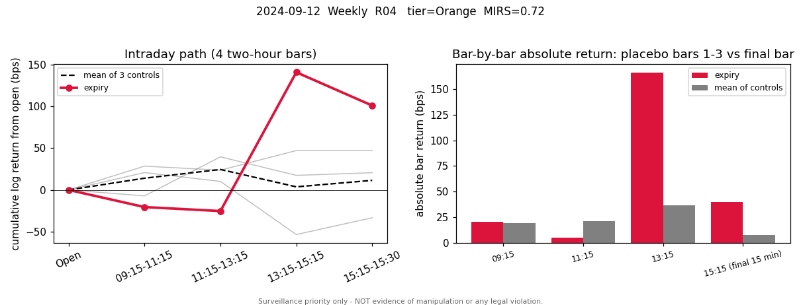

| Measure | Expiry | Mean of 3 controls |
|---|---|---|
| Day return | +1.46% | - |
| Intraday realised vol (EVR vs controls) | 1.72%  (EVR 3.22) | 0.53% |
| Final 15 min absolute return | 39.9 bps | 7.8 bps |
| Final 15 min range | 42.1 bps | 13.6 bps |
| Last-bar share of price path | 17.2% | 7.2% |
| Overnight gap (signed) | +0.44% | - |
| Next-day return | +0.12% | - |
| Listed events within +-5 days | 0 | - |

**Score components (past-only percentiles):** A (whole-day anomaly) 0.97 | T (settlement timing) 0.96 | R (reversal) 0.50 | Recurrence 0.00 | signals 2 | U 0.72 | news explanation 0.00 | **MIRS 0.72** | rank 3 of 239

ML consensus (median of IF/LOF/SVM percentiles) 0.97; at least 2 of 3 models above 0.90: yes  (secondary flag; ML is not inside MIRS)

**Strongest legitimate explanations to test FIRST (devil's-advocate rule; auto-generated hypotheses, not findings):**
- No rule-based innocent explanation triggered; test the generic ones below.
- Delta/gamma hedging, roll/unwind, arbitrage convergence, index rebalancing and liquidity cannot be tested with spot-only data
  (need OI by strike, futures, constituents, volume/spread/depth).

**WP7 news / information evidence (to be filled with dated, cited sources before any conclusion):**
- [ ] RBI / macro release on or before this date:  source ______  time ______
- [ ] Corporate or index announcement (heavy NIFTY constituents):  source ______  time ______
- [ ] Global market move overnight / intraday:  source ______  time ______
- Conclusion (one sentence, in surveillance language): ______

**Data needed to go further:** F&O bhavcopy (OI, strike distribution, futures basis), constituent prices and weights, intraday volume.
> Surveillance priority only - NOT evidence of manipulation or any legal violation.

---

## 2025-04-30 - Monthly expiry, regime R09 - **Amber**
*Selected because:* top-4 settlement-timing T (walk-forward)   |   *Run:* walk-forward (out-of-sample)

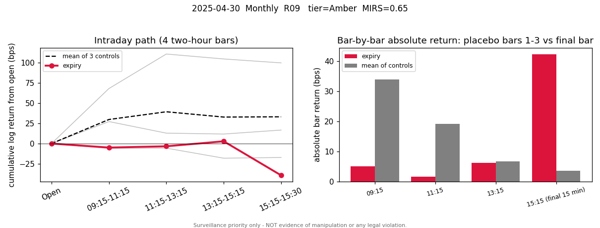

| Measure | Expiry | Mean of 3 controls |
|---|---|---|
| Day return | -0.34% | - |
| Intraday realised vol (EVR vs controls) | 0.43%  (EVR 1.02) | 0.42% |
| Final 15 min absolute return | 42.2 bps | 3.6 bps |
| Final 15 min range | 63.4 bps | 12.8 bps |
| Last-bar share of price path | 76.8% | 6.3% |
| Overnight gap (signed) | +0.06% | - |
| Next-day return | +0.27% | - |
| Listed events within +-5 days | 0 | - |

**Score components (past-only percentiles):** A (whole-day anomaly) 0.48 | T (settlement timing) 1.00 | R (reversal) 0.79 | Recurrence 0.00 | signals 1 | U 0.65 | news explanation 0.00 | **MIRS 0.65** | rank 13 of 239

ML consensus (median of IF/LOF/SVM percentiles) 0.99; at least 2 of 3 models above 0.90: yes  (secondary flag; ML is not inside MIRS)

**Strongest legitimate explanations to test FIRST (devil's-advocate rule; auto-generated hypotheses, not findings):**
- Monthly expiry: larger open interest is rolled, hedged or unwound into the close (WP2 found the final-bar effect concentrated in monthlies). Needs OI/rollover data to test.
- Quiet day overall but an active close: look at roll/unwind, delta hedging and VWAP-targeting execution first.
- Delta/gamma hedging, roll/unwind, arbitrage convergence, index rebalancing and liquidity cannot be tested with spot-only data
  (need OI by strike, futures, constituents, volume/spread/depth).

**WP7 news / information evidence (to be filled with dated, cited sources before any conclusion):**
- [ ] RBI / macro release on or before this date:  source ______  time ______
- [ ] Corporate or index announcement (heavy NIFTY constituents):  source ______  time ______
- [ ] Global market move overnight / intraday:  source ______  time ______
- Conclusion (one sentence, in surveillance language): ______

**Data needed to go further:** F&O bhavcopy (OI, strike distribution, futures basis), constituent prices and weights, intraday volume.
> Surveillance priority only - NOT evidence of manipulation or any legal violation.

---

## 2025-05-08 - Weekly expiry, regime R09 - **Amber**
*Selected because:* top-4 settlement-timing T (walk-forward)   |   *Run:* walk-forward (out-of-sample)

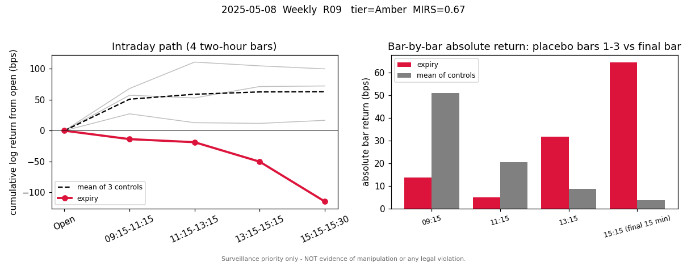

| Measure | Expiry | Mean of 3 controls |
|---|---|---|
| Day return | -1.05% | - |
| Intraday realised vol (EVR vs controls) | 0.73%  (EVR 1.27) | 0.58% |
| Final 15 min absolute return | 64.4 bps | 3.6 bps |
| Final 15 min range | 66.1 bps | 10.5 bps |
| Last-bar share of price path | 56.2% | 5.2% |
| Overnight gap (signed) | +0.09% | - |
| Next-day return | -0.49% | - |
| Listed events within +-5 days | 0 | - |

**Score components (past-only percentiles):** A (whole-day anomaly) 0.73 | T (settlement timing) 1.00 | R (reversal) 0.35 | Recurrence 0.00 | signals 1 | U 0.67 | news explanation 0.00 | **MIRS 0.67** | rank 9 of 239

ML consensus (median of IF/LOF/SVM percentiles) 0.98; at least 2 of 3 models above 0.90: yes  (secondary flag; ML is not inside MIRS)

**Strongest legitimate explanations to test FIRST (devil's-advocate rule; auto-generated hypotheses, not findings):**
- No rule-based innocent explanation triggered; test the generic ones below.
- Delta/gamma hedging, roll/unwind, arbitrage convergence, index rebalancing and liquidity cannot be tested with spot-only data
  (need OI by strike, futures, constituents, volume/spread/depth).

**WP7 news / information evidence (to be filled with dated, cited sources before any conclusion):**
- [ ] RBI / macro release on or before this date:  source ______  time ______
- [ ] Corporate or index announcement (heavy NIFTY constituents):  source ______  time ______
- [ ] Global market move overnight / intraday:  source ______  time ______
- Conclusion (one sentence, in surveillance language): ______

**Data needed to go further:** F&O bhavcopy (OI, strike distribution, futures basis), constituent prices and weights, intraday volume.
> Surveillance priority only - NOT evidence of manipulation or any legal violation.

---

## 2025-05-22 - Weekly expiry, regime R09 - **Green**
*Selected because:* top-8 MIRS (walk-forward)   |   *Run:* walk-forward (out-of-sample)

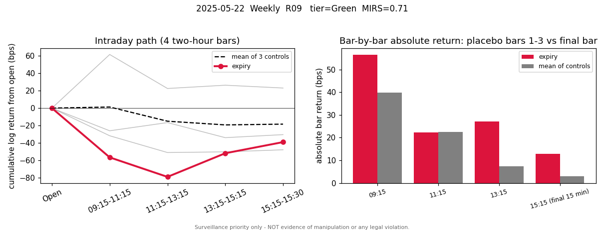

| Measure | Expiry | Mean of 3 controls |
|---|---|---|
| Day return | -0.66% | - |
| Intraday realised vol (EVR vs controls) | 0.68%  (EVR 1.42) | 0.48% |
| Final 15 min absolute return | 12.8 bps | 3.0 bps |
| Final 15 min range | 20.2 bps | 9.3 bps |
| Last-bar share of price path | 10.8% | 4.5% |
| Overnight gap (signed) | -0.27% | - |
| Next-day return | +0.86% | - |
| Listed events within +-5 days | 0 | - |

**Score components (past-only percentiles):** A (whole-day anomaly) 0.79 | T (settlement timing) 0.84 | R (reversal) 0.84 | Recurrence 0.25 | signals 0 | U 0.71 | news explanation 0.00 | **MIRS 0.71** | rank 4 of 239

ML consensus (median of IF/LOF/SVM percentiles) 0.67; at least 2 of 3 models above 0.90: no  (secondary flag; ML is not inside MIRS)

**Strongest legitimate explanations to test FIRST (devil's-advocate rule; auto-generated hypotheses, not findings):**
- No rule-based innocent explanation triggered; test the generic ones below.
- Delta/gamma hedging, roll/unwind, arbitrage convergence, index rebalancing and liquidity cannot be tested with spot-only data
  (need OI by strike, futures, constituents, volume/spread/depth).

**WP7 news / information evidence (to be filled with dated, cited sources before any conclusion):**
- [ ] RBI / macro release on or before this date:  source ______  time ______
- [ ] Corporate or index announcement (heavy NIFTY constituents):  source ______  time ______
- [ ] Global market move overnight / intraday:  source ______  time ______
- Conclusion (one sentence, in surveillance language): ______

**Data needed to go further:** F&O bhavcopy (OI, strike distribution, futures basis), constituent prices and weights, intraday volume.
> Surveillance priority only - NOT evidence of manipulation or any legal violation.

---

## 2025-06-19 - Weekly expiry, regime R09 - **Amber**
*Selected because:* top-4 settlement-timing T (walk-forward)   |   *Run:* walk-forward (out-of-sample)

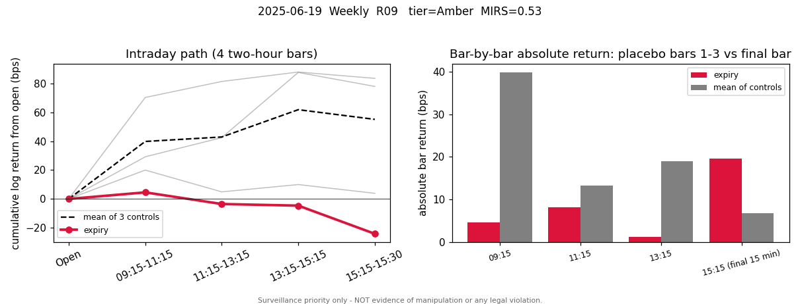

| Measure | Expiry | Mean of 3 controls |
|---|---|---|
| Day return | -0.22% | - |
| Intraday realised vol (EVR vs controls) | 0.22%  (EVR 0.42) | 0.51% |
| Final 15 min absolute return | 19.5 bps | 6.7 bps |
| Final 15 min range | 28.9 bps | 12.5 bps |
| Last-bar share of price path | 58.7% | 9.3% |
| Overnight gap (signed) | +0.02% | - |
| Next-day return | +1.36% | - |
| Listed events within +-5 days | 0 | - |

**Score components (past-only percentiles):** A (whole-day anomaly) 0.14 | T (settlement timing) 0.98 | R (reversal) 0.50 | Recurrence 0.00 | signals 1 | U 0.53 | news explanation 0.00 | **MIRS 0.53** | rank 53 of 239

ML consensus (median of IF/LOF/SVM percentiles) 0.80; at least 2 of 3 models above 0.90: no  (secondary flag; ML is not inside MIRS)

**Strongest legitimate explanations to test FIRST (devil's-advocate rule; auto-generated hypotheses, not findings):**
- Quiet day overall but an active close: look at roll/unwind, delta hedging and VWAP-targeting execution first.
- Delta/gamma hedging, roll/unwind, arbitrage convergence, index rebalancing and liquidity cannot be tested with spot-only data
  (need OI by strike, futures, constituents, volume/spread/depth).

**WP7 news / information evidence (to be filled with dated, cited sources before any conclusion):**
- [ ] RBI / macro release on or before this date:  source ______  time ______
- [ ] Corporate or index announcement (heavy NIFTY constituents):  source ______  time ______
- [ ] Global market move overnight / intraday:  source ______  time ______
- Conclusion (one sentence, in surveillance language): ______

**Data needed to go further:** F&O bhavcopy (OI, strike distribution, futures basis), constituent prices and weights, intraday volume.
> Surveillance priority only - NOT evidence of manipulation or any legal violation.

---

## 2026-06-23 - Weekly expiry, regime R12 - **Amber**
*Selected because:* top-8 MIRS (walk-forward)   |   *Run:* walk-forward (out-of-sample)

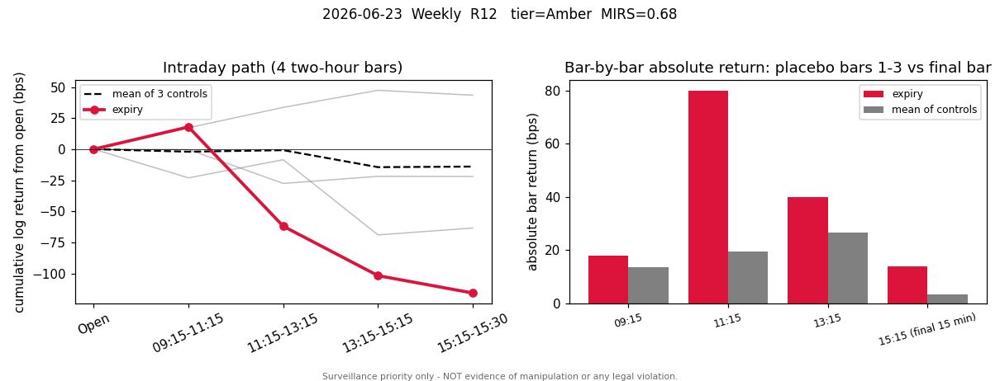

| Measure | Expiry | Mean of 3 controls |
|---|---|---|
| Day return | -1.22% | - |
| Intraday realised vol (EVR vs controls) | 0.92%  (EVR 2.26) | 0.41% |
| Final 15 min absolute return | 14.0 bps | 3.2 bps |
| Final 15 min range | 18.7 bps | 11.2 bps |
| Last-bar share of price path | 9.2% | 4.5% |
| Overnight gap (signed) | -0.07% | - |
| Next-day return | +0.93% | - |
| Listed events within +-5 days | 0 | - |

**Score components (past-only percentiles):** A (whole-day anomaly) 0.91 | T (settlement timing) 0.83 | R (reversal) 0.75 | Recurrence 0.00 | signals 1 | U 0.68 | news explanation 0.00 | **MIRS 0.68** | rank 8 of 239

ML consensus (median of IF/LOF/SVM percentiles) 0.50; at least 2 of 3 models above 0.90: no  (secondary flag; ML is not inside MIRS)

**Strongest legitimate explanations to test FIRST (devil's-advocate rule; auto-generated hypotheses, not findings):**
- No rule-based innocent explanation triggered; test the generic ones below.
- Delta/gamma hedging, roll/unwind, arbitrage convergence, index rebalancing and liquidity cannot be tested with spot-only data
  (need OI by strike, futures, constituents, volume/spread/depth).

**WP7 news / information evidence (to be filled with dated, cited sources before any conclusion):**
- [ ] RBI / macro release on or before this date:  source ______  time ______
- [ ] Corporate or index announcement (heavy NIFTY constituents):  source ______  time ______
- [ ] Global market move overnight / intraday:  source ______  time ______
- Conclusion (one sentence, in surveillance language): ______

**Data needed to go further:** F&O bhavcopy (OI, strike distribution, futures basis), constituent prices and weights, intraday volume.
> Surveillance priority only - NOT evidence of manipulation or any legal violation.

---
